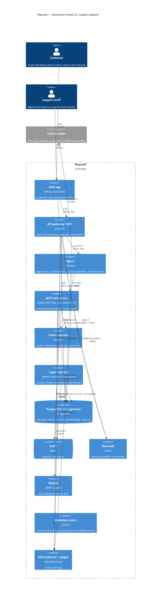

# Architecture

Status: **target architecture**. Containers are introduced milestone by milestone; the table below marks which ones exist today.

## Container diagram

## Containers

| Container | Path | Milestone | Status |
|---|---|---|---|
| Mailpit | `docker-compose.yml` | M0 | running |
| PostgreSQL + pgvector, Redis, Keycloak | `infra/` | M1 | running |
| Gateway | `services/gateway/` | M1 | running (auth, `/api/me`) |
| Orders service | `services/orders/` | M1–M2 | running (schema, seed, health); API in M2 |
| Metadata mock | `services/metadata-mock/` | M2 | planned |
| Web app | `apps/web/` | M3 | planned |
| Agent | `services/agent/` | M4 | planned |
| Ingest worker | `services/ingest-worker/` | M5 | planned |
| MCP tool server | `services/mcp-tools/` | M6 | planned |
| OTel Collector, Jaeger | `infra/otel/` | M8 | planned |

## Identity and tenancy

- One Keycloak realm, `northwind`, serves both tenants. A user's tenant is the `tenant` attribute in the realm's declarative user profile, editable by admins only, and emitted as a `tenant` claim by a protocol mapper on the `mayushi-web` client.
- The web app is a confidential OIDC client (backend-for-frontend) using authorisation code + PKCE (S256), with exact redirect URIs. Direct access grants are disabled. The client secret is generated by `make bootstrap` and applied by `make seed`.
- Access tokens carry the audience `mayushi-api` and live for 5 minutes; refresh tokens rotate and are single-use. The gateway validates signature (RS256/ES256 via a bounded JWKS cache), issuer, audience, `exp`/`nbf` and `typ`, then resolves the tenant claim against `app.tenants` and keeps only known realm roles: `customer`, `support_agent`, `support_admin`.
- The issuer is the browser-facing URL (`http://localhost:8080`); services fetch JWKS over the Docker network (`http://keycloak:8080`).

## Data

One PostgreSQL 16 instance (with pgvector) hosts:

| Database / schema | Owner (migrations) | Runtime role and grants | Contents |
|---|---|---|---|
| `keycloak` | `keycloak` | `keycloak` | Keycloak state |
| `mayushi.app` | `gateway_migrator` | `gateway_svc`: `SELECT` on `tenants` | Tenants (later: conversations, uploads) |
| `mayushi.orders` | `orders_migrator` | `orders_svc`: DML on business tables | Customers, addresses, orders, order items, payments |

Each service runs its own Alembic history (`<schema>.alembic_version`) in a one-shot `<svc>-migrate` job that holds the owner credentials; the long-running service starts only after that job succeeds and holds runtime credentials only. Runtime privileges are granted explicitly by migrations (deny by default). `make seed` regenerates the orders data from a fixed Faker seed, so IDs and values are identical on every run. See ADR-0005.

## Network

All containers share the `mayushi_backend` Docker network. Host-published ports bind to `127.0.0.1` only. The stack runs offline; the only optional outbound dependency is the configured LLM provider.
